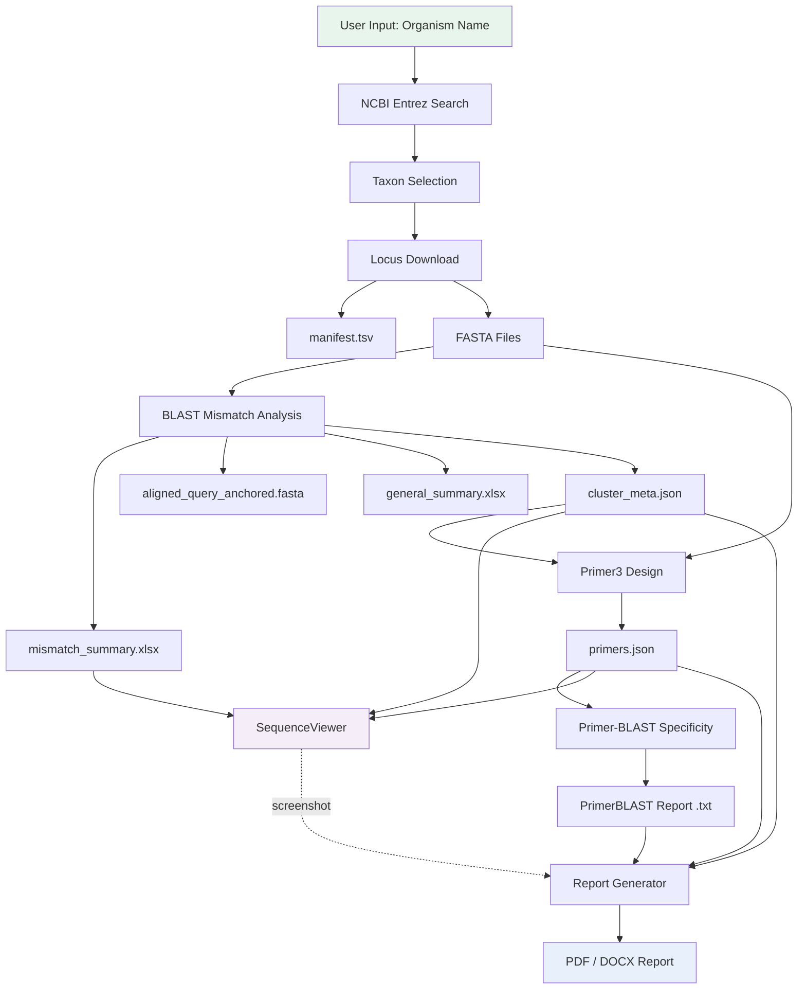
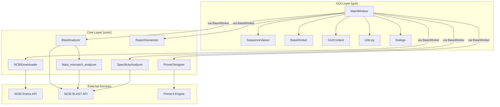
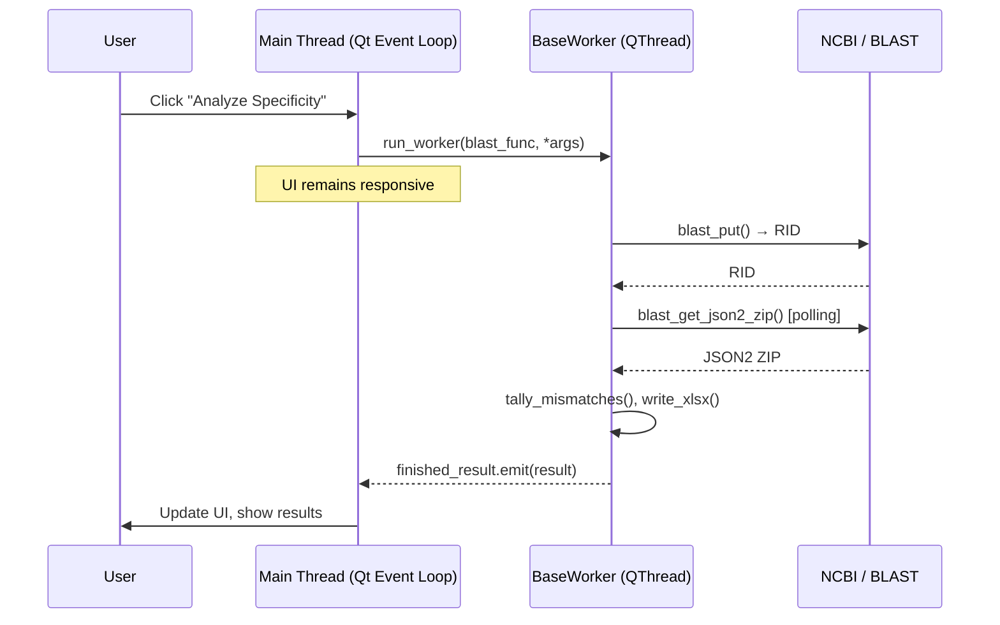
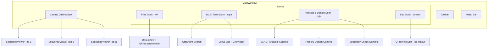

# Architecture

> Technical design and data flow of the Primery application

---

## Project Structure

```
Primery/
├── primery_app.py              # Entry point (splash screen + MainWindow)
├── requirements.txt            # Python dependencies
├── run.bat                     # Cross-platform launcher (Bash + CMD)
├── clean_install.bat           # Reset embedded Python environment
├── debug.bat                   # Debug launcher with verbose output
├── README.md                   # English documentation
├── README_ru.md                # Russian documentation
│
├── core/                       # Business logic (no GUI dependencies)
│   ├── __init__.py
│   ├── ncbi_downloader.py      # NCBI Entrez search and download
│   ├── blast_analyzer.py       # GUI-facing BLAST wrapper
│   ├── blast_mismatch_analyzer.py  # Low-level BLAST + mismatch tallying
│   ├── primer_designer.py      # Cluster-pair Primer3 design
│   ├── primer_specificity.py   # Primer-BLAST specificity checking
│   ├── probe_catalog.py        # Probe dye/quencher/modification catalog
│   ├── probe_designer.py       # qPCR, beacon, MGB-style, and RPA probe design
│   ├── probe_specificity.py    # Primer + probe assay specificity classification
│   └── report_generator.py     # PDF/DOCX report generation
│
├── gui/                        # PySide6 user interface
│   ├── __init__.py
│   ├── main_window.py          # MainWindow with docks, toolbar, menu
│   ├── sequence_viewer.py      # QGraphicsView sequence visualization
│   ├── editor_widget.py        # Text/FASTA editor widgets
│   ├── report_viewers.py       # In-app primer and specificity table viewers
│   ├── settings_dialog.py      # Preferences dialog
│   ├── workers.py              # BaseWorker QThread wrapper
│   ├── gui_context.py          # Global state singleton
│   ├── i18n.py                 # EN/RU string dictionary
│   ├── dialogs.py              # MismatchDialog, PrimerSettingsDialog
│   ├── selection_dialog.py     # Organism/gene selection tree
│   ├── report_dialog.py        # Report generation options
│   └── widgets.py              # HintLabel, Separator
│
├── assets/                     # Application resources
│   ├── Logo.png                # Application icon
│   ├── Logo.ico                # Windows icon (auto-generated)
│   ├── Loading.svg             # Splash screen SVG
│   └── fonts/
│       └── Inter-Bold.ttf      # Bundled font for splash
│
├── docs/                       # Documentation
│   ├── getting_started.md
│   ├── feature_guidelines.md   # v0.2 primer/probe workflow guidance
│   ├── user_manual.md
│   ├── cli_reference.md
│   ├── api_reference.md
│   ├── architecture.md         # (this file)
│   ├── output_format.md
│   ├── troubleshooting.md
│   ├── developers.md
│   └── science.md
├── CHANGELOG.md                # Release notes
│
├── _legacy/                    # CLI-only scripts (predecessor tools)
│   ├── fusarium_pipeline.py
│   ├── download_fusarium_loci.py
│   ├── ncbi_loci_interactive.py
│   ├── primer3_designer.py
│   ├── primerblast_interactive.py
│   ├── report_builder.py
│   └── pyinstaller.spec
│
└── python_embed/               # Bundled Python + packages (Windows distribution)
    └── Lib/site-packages/...
```

---

## Technology Stack

| Component | Library | Version | Purpose |
|-----------|---------|---------|---------|
| GUI Framework | PySide6 | ≥ 6.0.0 | Qt for Python — widgets, graphics, threading |
| Bioinformatics | Biopython | ≥ 1.80 | Entrez API, SeqIO, BLAST (NCBIWWW/NCBIXML) |
| Primer Design | primer3-py | ≥ 2.0.0 | Primer3 engine bindings |
| Spreadsheets | openpyxl | ≥ 3.0.0 | XLSX reading and writing |
| PDF Reports | ReportLab | ≥ 3.6.0 | A4 PDF generation with custom typography |
| Word Reports | python-docx | ≥ 0.8.11 | DOCX generation with styled tables |
| HTTP | requests | ≥ 2.28.0 | NCBI BLAST Common URL API |
| Runtime | Python | 3.12 | Language runtime (Miniforge/Conda) |

---

## Data Flow



---

## Component Architecture



---

## Threading Model

All long-running operations (NCBI downloads, BLAST submissions, Primer3 design, report generation) execute in background threads to keep the GUI responsive.



**Key components:**

- **`MainWindow`** runs on the Qt main thread. All UI updates must happen here.
- **`BaseWorker(QThread)`** takes a callable `func` and its arguments. Executes `func(*args, **kwargs)` in `run()`.
- **`finished_result = Signal(object)`** delivers the return value back to the main thread.
- **`error_occurred = Signal(str)`** delivers exception messages.
- **`run_worker()`** in `MainWindow` creates the worker, connects signals, starts the thread, and keeps a reference to prevent garbage collection.
- **`StreamRedirector`** captures `sys.stdout` / `sys.stderr` and emits a `message = Signal(str)` for each line, which the log dock consumes.

---

## GUI Architecture



**Dock positions:**
- **Files** — Left side, shows workspace file tree
- **NCBI Tools** — Right side, organism search and locus download
- **Analysis & Design** — Right side (below NCBI Tools), BLAST/Primer3/specificity controls
- **Log** — Bottom, captures stdout/stderr output

---

## Internationalization Architecture

The i18n system uses a flat dictionary approach:

```
gui/i18n.py
├── STRINGS['en'] → { 'app_title': '...', 'workspace': '...', ... }
├── STRINGS['ru'] → { 'app_title': '...', 'workspace': '...', ... }
└── tr(lang, key) → STRINGS[lang][key] or key
```

- `GUIContext.lang` holds the current language (`"en"` or `"ru"`)
- `GUIContext.language_changed` signal notifies components of language switches
- UI strings are retrieved via `tr(context.lang, "key_name")` throughout the GUI code
- Runtime switching is supported — changing `lang` triggers UI refresh

---

## Directory Contract

The workspace follows a strict directory structure:

```
{Workspace}/
└── {Organism}/
    ├── Genes/
    │   └── {Gene}/
    │       └── {Gene}__{Accession}.fasta
    ├── BLAST/
    │   └── {Gene}/
    │       ├── {hash}__{Accession}__mismatch_summary.xlsx
    │       ├── {hash}__{Accession}__aligned_query_anchored.fasta
    │       ├── {hash}__{Accession}__blast_JSON2.zip
    │       ├── {hash}__{Accession}__.done.json
    │       ├── {Gene}_general_summary.xlsx
    │       ├── {Gene}_cluster_meta.json
    │       └── {Gene}_{method}_primers.json
    ├── Primer-BLAST/
    │   └── PrimerBLAST_{timestamp}.txt
    ├── Reports/
    │   ├── report.pdf
    │   └── report.docx
    └── {Organism}_loci.tsv
```

The `{hash}` prefix is a 24-character truncated SHA-256 of the query sequence and BLAST parameters, enabling automatic caching. If a `.done.json` file exists alongside the output files, re-analysis is skipped unless `--force` is used.
